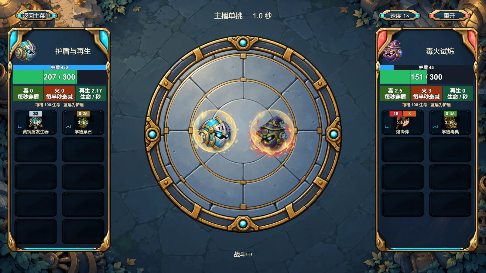
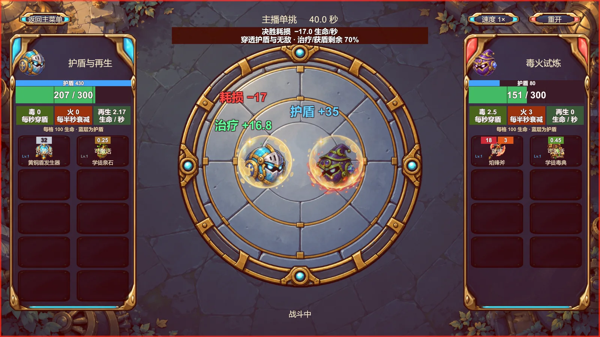

# PKBall：弹珠决斗与肉鸽构筑

用装备组合出一场看得懂的战斗。PKBall 是 Unity / C# 单机原型，把圆环装备构筑、冒险经营和弹射自动决斗放在同一套战斗系统中；另提供可配置双方的主播单挑模式。

[在线试玩](https://bishop-zh.github.io/pkball/) · [个人作品集](https://bishop-zh.github.io/#pkball) · [设计与实现文档](Docs/README.md)



## 怎么玩

- **冒险**：从主菜单进入冒险，在准备阶段处理事件、购买道具、管理背包和装备环，再进入战斗。按场内提示拖动鼠标确定弹射方向，松开发射；装备效果自动触发，战斗结束后继续经营与成长。
- **主播模式**：在主菜单选择主播模式，配置红蓝双方的角色、属性和装备，点击“开始单挑”观看自动战斗。支持变速、重播与返回配置，适合对照不同构筑。
- **网页试玩**：推荐使用桌面 Chrome / Edge 和鼠标键盘。首次加载需要下载游戏资源；点击“开始加载”后进入游戏，可使用网页上的全屏按钮。浏览器本地数据随站点数据保存，清除站点数据会删除对应存档与配置，不与桌面版同步。

当前为单机原型。冒险中的对手由本地模拟提供，真实玩家匹配、在线房间和多人服务器尚未接入。文档中关于未来多人、赛季等内容属于规划。

## 已实现的主要内容

| 模块 | 内容 |
| --- | --- |
| 构筑与经营 | 商店、每日事件、背包、圆环装备格、道具合成与成长 |
| 战斗 | 弹射与墙壁反弹、碰撞、近远程自动攻击、毒 / 火 / 护盾 / 治疗与决胜阶段 |
| 主播单挑 | 双方独立配置、角色与对战预设、JSON 配置、重播和变速 |
| 共用表现 | 冒险与主播模式复用战斗逻辑、道具效果、生命护盾显示与攻击表现 |
| 内容与配置 | ScriptableObject 与 JSON 目录、角色道具定义、项目内置编辑工具 |



截图来自项目本地运行记录，仅压缩编码以便网页阅读。它们展示具体构筑样例，不代表所有对局的固定数值。

## 在 Unity 中运行

1. 使用 Unity Hub 添加仓库根目录，编辑器版本为 **Unity 2022.3.62f3c1**。
2. 等待 `Packages/manifest.json` 中的依赖恢复（URP 14、UGUI、TextMeshPro 等）。
3. 打开 `Assets/PKBall/Scenes/MainMenu.unity`，点击 Play。

构建场景依次为 MainMenu、Preparation、PrototypeBattle，均在 `Assets/PKBall/Scenes/`。场景和界面已保存，通常不需要先运行生成工具。

## 构建网页试玩

在 Unity Hub 为此编辑器安装 **WebGL Build Support**。使用仓库中的 `PortfolioWebGLBuild.Build` 生成静态文件，例如在 PowerShell 中执行（按本机位置修改编辑器与工程路径）：

```powershell
& 'C:\Unity\2022.3.62f3c1\Editor\Unity.exe' -batchmode -quit -projectPath 'C:\Projects\PKBall' -buildTarget WebGL -executeMethod PortfolioWebGLBuild.Build -portfolioOutput 'C:\Builds\pkball' -logFile 'C:\Builds\pkball.log'
```

构建器采用 gzip 和 Unity 解压回退，可用于无法自定义压缩响应头的静态托管。构建输出通过本仓库 `gh-pages` 分支发布，独立于个人主页；源代码 `main` 分支不提交 Unity 缓存或构建二进制。详细发布说明见 [WEBGL.md](WEBGL.md)。

## 代码与文档入口

- `Assets/PKBall/Scripts/`：主要运行逻辑；`Assets/PKBall/Editor/`：项目编辑器工具。
- `Assets/PKBall/Resources/`：配置与美术资源；`Assets/PKBall/Scenes/`：运行场景。
- `Assets/Editor/PortfolioWebGLBuild.cs`：WebGL 批处理构建入口。
- `Packages/`、`ProjectSettings/`：Unity 依赖和项目设置。
- `Docs/`：设计和实现记录。建议先读 [文档索引](Docs/README.md)、[状态边界与统一战斗调度](Docs/40-状态边界与统一战斗调度.md)、[观战信息与数值平衡](Docs/41-观战信息与数值平衡基线.md) 和 [当前产品方向](Docs/42-双轨产品规划与内容规则.md)。
- `Tools/`：素材处理与内容检查工具。

文档按开发阶段保留历史记录，早期的格位、数值与“尚未实现”列表可能已过期；以文档索引指向的最新专题和当前代码为准。

## 仓库与同步

- [GitHub](https://github.com/Bishop-zh/pkball)：源代码与独立 Pages 试玩站。
- [Gitee](https://gitee.com/sillybishop/pkball)：源代码镜像。

两个平台需要分别推送，不会自动同步。Unity 缓存、临时文件、构建产物、日志、IDE 自动生成文件和本地凭据均不入源码分支。
